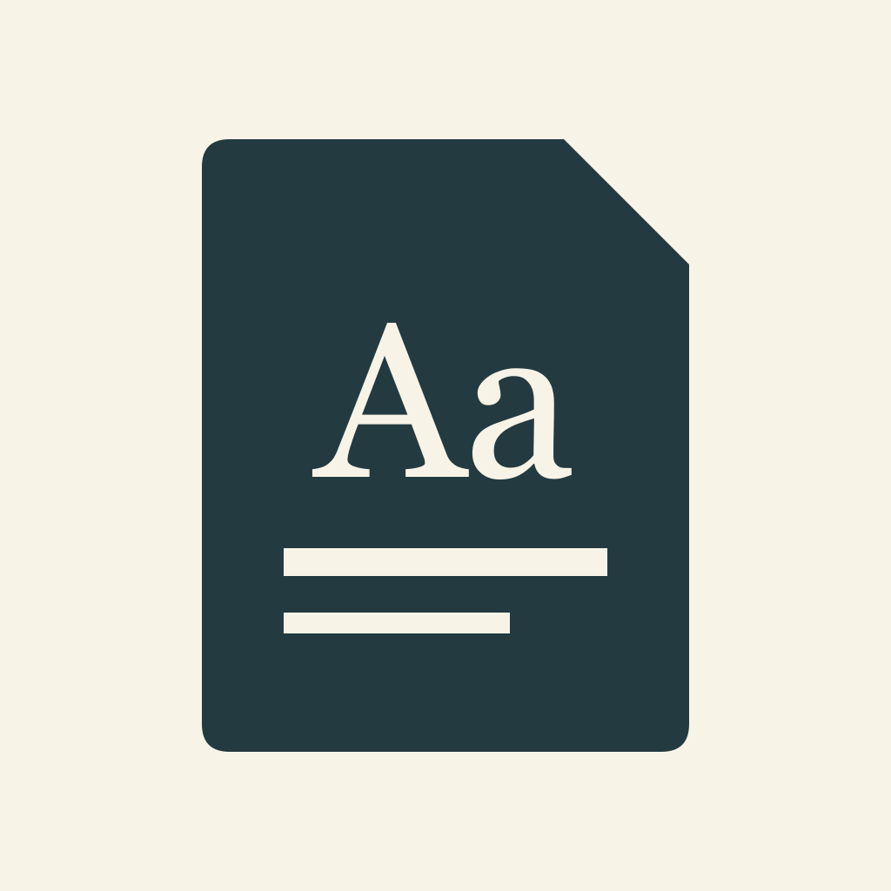
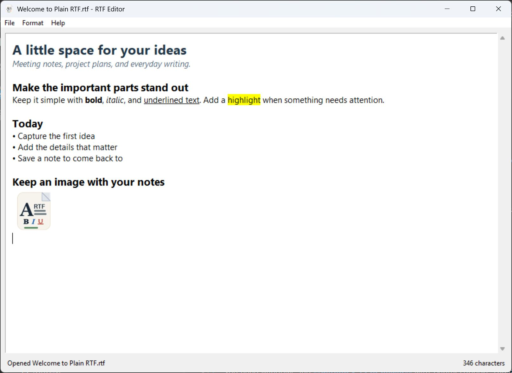

<!-- last_updated: 2026-11-09 -->

# Plain RTF

A super lightweight Plain Text RTF editor.

Plain RTF is a cross-platform app for quick notes with text formatting and
embedded images.

**File compatibility:** documents use the app's own UTF-8 **Plain Text RTF**
format, identified by `PTRTF/1`. They normally have an `.rtf` extension, but
they are **not Microsoft RTF files**.

[User manual](docs/USER_MANUAL.md) ·
[Format specification](docs/PLAIN_RTF_SPEC.md) · [License](LICENSE)

## Screenshot

*A sample note in Plain RTF on Windows. Click the screenshot to view it full
size.*

## Features

- Bold, italic, underline, and strikethrough.
- Font families, font sizes, text colors, and background highlighting.
- Bulleted and numbered lists, plus simple text tables.
- Embedded PNG and JPEG images, including image paste on Windows.
- File drag-and-drop and familiar keyboard shortcuts.
- Portable executable and installer-oriented standalone build options.

## Getting started

## Windows Portable App

For a portable build, place `plain-rtf.exe` in a writable folder and
double-click it. Python does not need to be installed on the computer running
the EXE.

## Windows Installer

The portable app keeps its logs and temporary extracted files in
`plain-rtf-data/` beside the executable. Extraction files are removed on normal
exit; logs remain. Renaming the executable changes the corresponding data
folder name. Portable storage does not fall back to AppData.

## Android

Download Plain RTF from the [Google Play Store](https://play.google.com/store/apps/details?id=com.plaintextoffice.plain_rtf)

## Usage

1. Create a note with **File > New**, or open one with **File > Open...**.
1. Select text and use the **Format** menu to apply formatting.
1. Choose **Format > Insert Image...** to add an image.
1. Save with **Ctrl+S**. Use **Ctrl+Shift+S** to save under another name.

**Ctrl+B**, **Ctrl+I**, and **Ctrl+U** apply bold, italic, and underline to
selected text. Documents are saved when you request a save; there is no
automatic saving or recovery copy.

See the [user manual](docs/USER_MANUAL.md) for complete instructions, shortcuts,
file-format details, and troubleshooting. The app's **Help** menu also lists
keyboard shortcuts and supported formatting.

## Contributing

When reporting a bug, include the steps to reproduce it, the expected behavior,
the actual behavior, and any error message. State whether you ran from source,
a portable executable, or an installed application. Share a small example
document with private information removed when it helps reproduce the problem.

## License

Plain RTF is proprietary software. Copyright (c) 2026 Plain Text Office LLC.
All rights reserved. See [LICENSE](LICENSE) for terms and permission requests.
