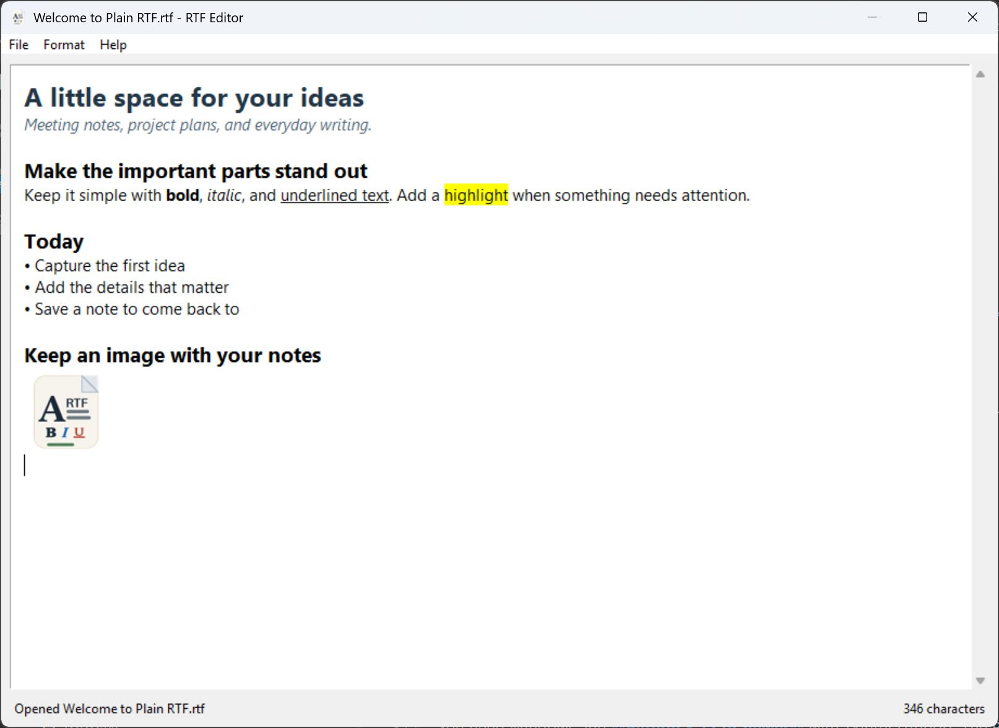
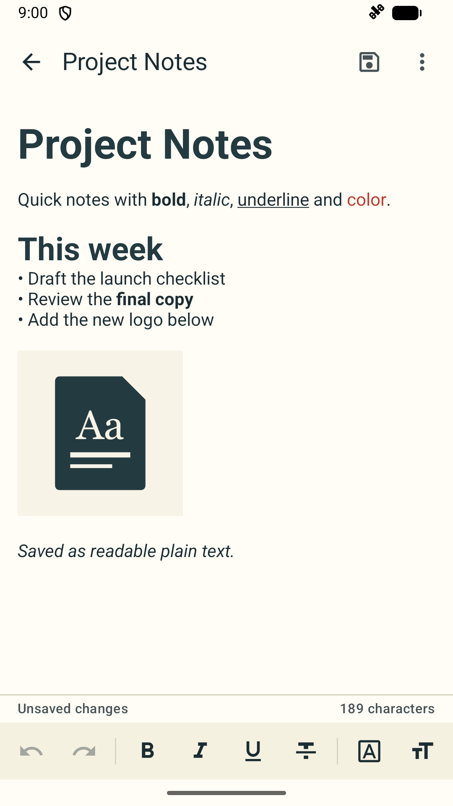
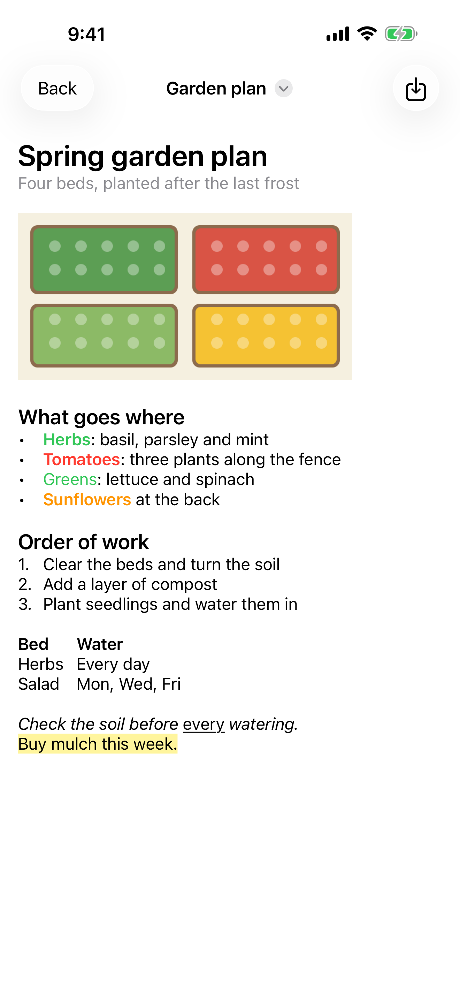

<!-- last_updated: 2026-11-21 -->
<!-- Authoring guidance: dev-docs/specs/README_SPEC.instructions.md -->
<!-- rumdl-disable MD033 MD041 -->

  

<h1 align="center">Plain RTF</h1>

  A lightweight editor for formatted notes, saved as plain text you can still
  read in any editor.

  
  

  <a href="#download">Download</a> ·
  <a href="docs/USER_MANUAL.md">User manual</a> ·
  <a href="docs/PLAIN_RTF_SPEC.md">Format specification</a> ·
  <a href="https://plaintxtoffice.com/apps/">Website</a>

<!-- rumdl-enable MD033 MD041 -->

---

## About

Plain RTF is an app for quick notes with text formatting and embedded images,
for Windows, Android, and iOS. Notes are saved wherever you choose, in a
documented plain-text format.

Documents use the app's own UTF-8 **Plain Text RTF** format, identified by
`PTRTF/1`. They normally have an `.rtf` extension, but they are **not Microsoft
RTF files**. See the [format specification](docs/PLAIN_RTF_SPEC.md) for the
full syntax.

## Features

- Bold, italic, and underline, plus strikethrough on Windows and Android.
- Font sizes and text colors, plus font families and background highlighting
  on Windows and Android. The iOS app keeps strikethrough, fonts, and
  highlights already in a note.
- Bulleted and numbered lists, plus simple text tables. The iOS app has no
  table command and shows tables as tab-separated text.
- Embedded PNG and JPEG images. Paste an image on any platform; on Windows and
  Android you can also insert one with a command or drag one in.
- Recovery drafts of unsaved changes on Android and iOS.
- Familiar keyboard shortcuts on Windows, and on Android with a hardware
  keyboard.

## App Screenshot

Click a screenshot to view it full size.

### Windows

### Android

<!-- rumdl-disable MD033 -->

  

<!-- rumdl-enable MD033 -->

### iOS

<!-- rumdl-disable MD033 -->

  

<!-- rumdl-enable MD033 -->

## Download

| Platform | Download | Notes |
| --- | --- | --- |
| Windows (portable) | [plain-rtf.exe](https://github.com/PlainTxtOffice/plain-rtf/releases/latest/download/plain-rtf.exe) | Runs without installation. |
| Windows (installer) | [plain-rtf-setup.exe](https://github.com/PlainTxtOffice/plain-rtf/releases/latest/download/plain-rtf-setup.exe) | |
| Android | [Google Play](https://play.google.com/store/apps/details?id=com.plaintxtoffice.plainrtf) | Requires Android 9 or later. |
| iOS | [App Store](https://apps.apple.com/app/id6837573461) | Requires an iPhone with iOS 26.4 or later. |

The Windows builds are for x64 (64-bit) and do not need Python installed.

## User Manual

See the [User Manual](docs/USER_MANUAL.md) for installation, usage, keyboard
shortcuts, file-format details, and troubleshooting.

## Feedback

Bug reports and feature requests are welcome. In the Android app, tap
**Send feedback** on the Home screen or in the editor's menu. In the iOS app,
tap **Send Feedback** at the top of the Home screen. The Windows app has no
feedback command; use the
[contact form](https://plaintxtoffice.com/contact/) on plaintxtoffice.com.

## License

Plain RTF is proprietary software. Copyright (c) 2026 Plain Text Office LLC.
All rights reserved. See [LICENSE](LICENSE) for terms and permission requests.
