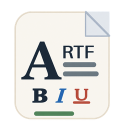
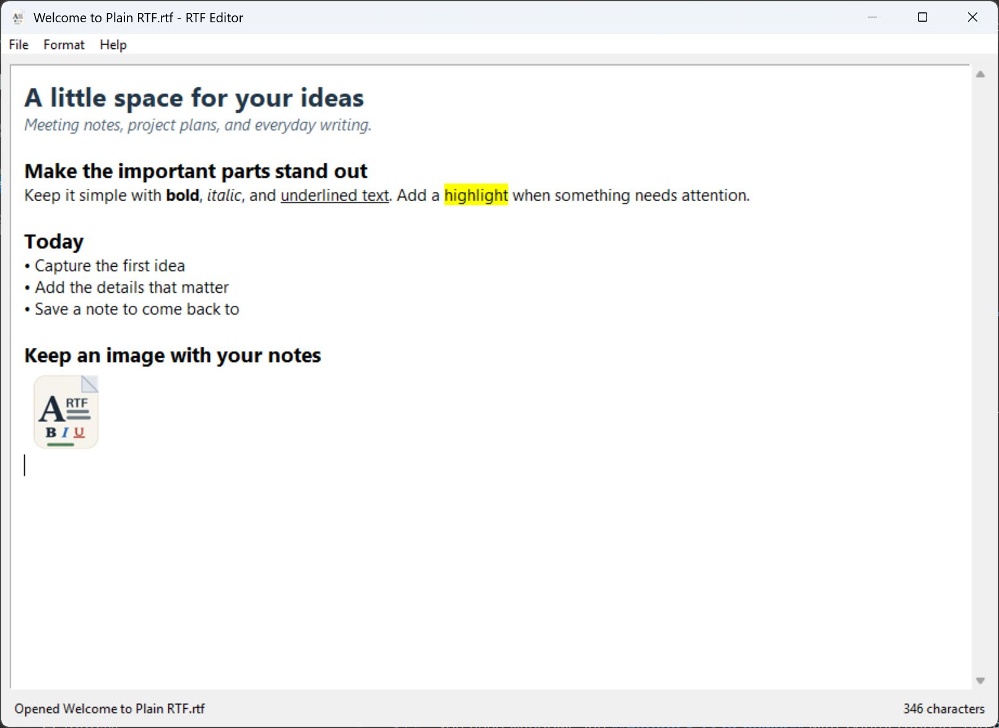

<!-- last_updated: 2026-10-21 -->

# Plain RTF



A super lightweight Plain Text RTF editor.

Plain RTF is a Windows desktop app for quick notes with text formatting and
embedded images. Its window is named **RTF Editor**.

**File compatibility:** documents use the app's own UTF-8 **Plain Text RTF**
format, identified by `PTRTF/1`. They normally have an `.rtf` extension, but
they are **not Microsoft RTF files**.

[User manual](docs/USER_MANUAL.md) ·
[Format specification](docs/PLAIN_RTF_SPEC.md) ·
[Build guide](scripts/nuitka/README.md)

## Screenshot

[](docs/images/plain-rtf-screenshot.jpg)

*A sample note in Plain RTF on Windows. Click the screenshot to view it full
size.*

## Features

- Bold, italic, underline, and strikethrough.
- Font families, font sizes, text colors, and background highlighting.
- Bulleted and numbered lists, plus simple text tables.
- Embedded PNG and JPEG images, including image paste on Windows.
- File drag-and-drop and familiar keyboard shortcuts.
- Portable executable and installer-oriented standalone build options.

## Getting started

### Run from source

You need Windows and **Python 3.12 or newer** with Tkinter support. The Python
dependencies, Pillow and tkinterdnd2, are installed by the commands below.

Download or clone this repository, then open PowerShell in its root folder:

```powershell
python -m venv .venv
.venv/Scripts/python.exe -m pip install -e .
.venv/Scripts/python.exe -m src.main
```

To open an existing Plain Text RTF document at startup:

```powershell
.venv/Scripts/python.exe -m src.main "C:/Users/YourName/Documents/My notes.rtf"
```

With the virtual environment activated, you can also launch the installed
`plain-rtf` command.

### Run a packaged application

For a portable build, place `plain-rtf.exe` in a writable folder and
double-click it. Python does not need to be installed on the computer running
the EXE.

The portable app keeps its logs and temporary extracted files in
`plain-rtf-data/` beside the executable. Extraction files are removed on normal
exit; logs remain. Renaming the executable changes the corresponding data
folder name. Portable storage does not fall back to AppData.

The standalone build is intended for an installer and uses
`%LOCALAPPDATA%/plain-rtf/` for application data. In either build, documents are
saved to the locations you choose.

## Usage

1. Create a note with **File > New**, or open one with **File > Open...**.
1. Select text and use the **Format** menu to apply formatting.
1. Choose **Format > Insert Image...** to add an image.
1. Save with **Ctrl+S**. Use **Ctrl+Shift+S** to save under another name.

**Ctrl+B**, **Ctrl+I**, and **Ctrl+U** apply bold, italic, and underline to
selected text. Documents are saved when you request a save; there is no
automatic saving or recovery copy.

See the [user manual](docs/USER_MANUAL.md) for complete instructions, shortcuts,
file-format details, and troubleshooting. The app's **Help** menu also lists
keyboard shortcuts and supported formatting.

## Build Windows executables

Set up the compiler and build dependencies using the
[build guide](scripts/nuitka/README.md), then run:

```powershell
./scripts/nuitka/onefile.ps1 -Commercial
./scripts/nuitka/standalone.ps1 -Commercial
```

| Build | Output | Distribution |
| --- | --- | --- |
| Onefile | `build/onefile/plain-rtf.exe` | Ship the EXE alone. |
| Standalone | `build/standalone/main.dist/` | Package the entire folder in your installer. |

`-Commercial` requires Nuitka Commercial and enables constant protection.
Free Nuitka can build with that switch omitted. The build guide covers release
validation, runtime storage, and Advanced Installer setup.

## Contributing

When reporting a bug, include the steps to reproduce it, the expected behavior,
the actual behavior, and any error message. State whether you ran from source,
a portable executable, or an installed application. Share a small example
document with private information removed when it helps reproduce the problem.

For development, install the tools and run the checks from the repository root:

```powershell
.venv/Scripts/python.exe -m pip install -e ".[dev]"
.venv/Scripts/python.exe -m pytest
.venv/Scripts/python.exe -m ruff check .
.venv/Scripts/python.exe -m mypy src
.venv/Scripts/rumdl.exe check README.md
```

Keep changes focused and include tests for behavior changes.

## License

The project declares the **MIT** license in [pyproject.toml](pyproject.toml).
